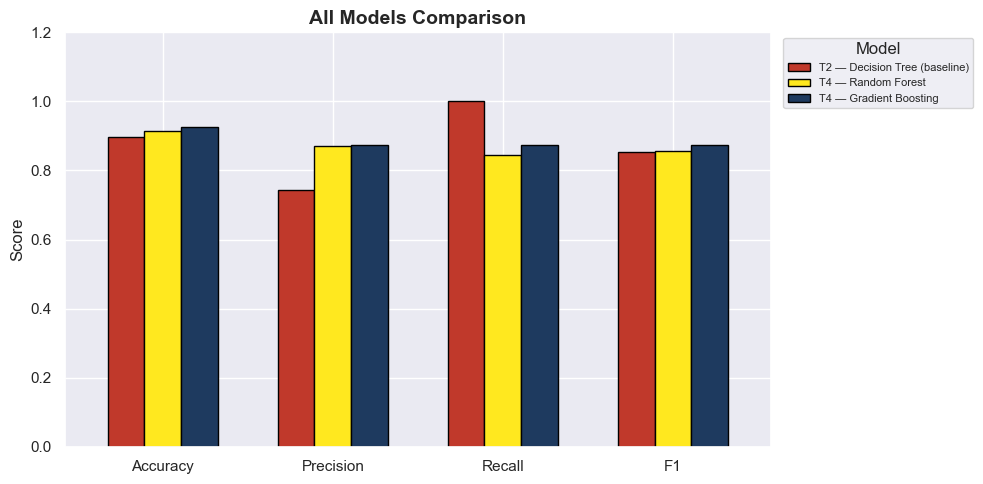
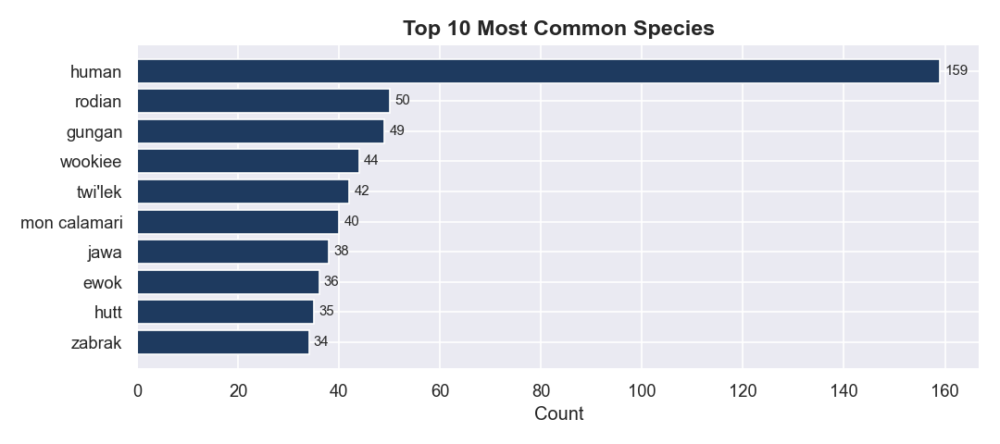
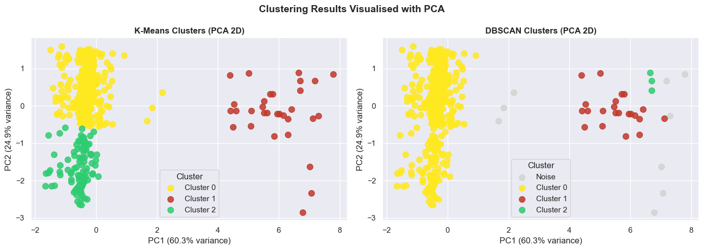

# Star Wars Species Classifier

**Machine Learning Midterm Project | Python · scikit-learn · Jupyter**

A learning project using Star Wars character attributes to explore whether a classifier can distinguish **Human** from **Non-Human** characters. The notebooks cover exploratory data analysis, supervised classification, unsupervised clustering, and ensemble models.

> **Scope:** Educational analysis on a small Star Wars character dataset. The reported performance metrics come from the project's saved CSV output files; they have not been independently rerun or revalidated for this GitHub release.

## Workflow

1. **Exploration and preparation** — inspect missing values, clean character characteristics, and visualize distributions (`notebooks/T1_EDA.ipynb`).
2. **Supervised classification** — compare Decision Tree and K-Nearest Neighbors models (`notebooks/T2_Supervised.ipynb`).
3. **Unsupervised learning** — analyze physical-feature clusters with K-Means and DBSCAN, visualized using PCA (`notebooks/T3_Unsupervised.ipynb`).
4. **Ensembles** — compare Random Forest and Gradient Boosting models (`notebooks/T4_Ensemble.ipynb`).

## Results saved in this project

| Model | Accuracy | Precision | Recall | F1 |
|---|---:|---:|---:|---:|
| Decision Tree | 0.896 | 0.744 | 1.000 | 0.853 |
| KNN (k=5) | 0.811 | 0.676 | 0.719 | 0.697 |
| Random Forest | 0.915 | 0.871 | 0.844 | 0.857 |
| Gradient Boosting | 0.925 | 0.875 | 0.875 | 0.875 |

Sources: `reports/supervised_results.csv` and `reports/all_models_summary.csv`. These are the values recorded by the project, not claims of external generalization.

## Sample visualizations







## Repository layout

```text
star-wars-species-classifier/
├── data/
│   ├── raw/characters.csv
│   ├── cleaned.csv
│   └── clustered.csv
├── notebooks/
│   ├── T1_EDA.ipynb
│   ├── T2_Supervised.ipynb
│   ├── T3_Unsupervised.ipynb
│   └── T4_Ensemble.ipynb
├── models/supervised_best.pkl
├── reports/
├── requirements.txt
└── README.md
```

## How to explore

Install the listed dependencies:

```bash
pip install -r requirements.txt
```

Open notebooks in sequence, starting with `notebooks/T1_EDA.ipynb`. The notebook paths assume you run them from the `notebooks` directory (for example, using Jupyter's interface). Output files are already included for inspection. Re-running might generate different results depending on package versions and execution environment.

**Note:** Some original notebook narrative cells still contain assignment placeholders (for example, `[X]`). The summary above uses the actual values saved in the reports. The trained `.pkl` file should only be loaded in a trusted environment.

## Dataset and attribution

The original project README identifies a SWAPI-derived Star Wars character dataset from [Kaggle](https://www.kaggle.com/datasets/jsphyg/star-wars). Check the dataset's current terms and attribution requirements before redistributing it elsewhere.

## Project status

University midterm assignment. This is an educational portfolio project, not a production classification system.
